# VENTRA UI Bible

The one source of truth for how VENTRA's app looks and how to build a screen. If something here disagrees with older code, this file wins.

- **Kit:** `apps/web/components/glass/` (import from `@/components/glass`)
- **Live gallery:** `/lab/components` (every component, working, at phone size)
- **Glass engine:** the real [`liquid-glass-react`](https://github.com/rdev/liquid-glass-react) 1.1.1 (MIT), wrapped in `apps/web/components/ui/liquid-glass-card.tsx`. Never imitate it with custom CSS.
- **Status:** new screens use this kit. Older screens still use `app/design-system/*` and `components/ui/glasscn/*` until each is rebuilt; do not add anything new on those.


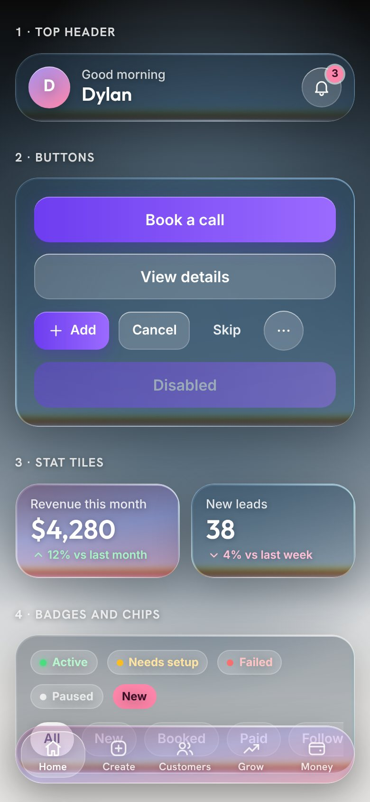

---

## 1. Quick start

```tsx
'use client';
import { GlassPage, GlassSection, GlassCard, GlassBottomNav } from '@/components/glass';

export default function CustomersScreen() {
  return (
    <GlassPage>
      <GlassSection title="Recent customers">
        <GlassCard>
          <div className="g-stack">
            <p>Your content here</p>
            <button type="button" className="g-btn g-btn-primary">Add a customer</button>
          </div>
        </GlassCard>
      </GlassSection>
      <GlassBottomNav current="customers" asLinks />
    </GlassPage>
  );
}
```

That is all a screen needs. `GlassPage` brings the fonts, the reset, the background, white text, space for the nav, and the context every glass piece uses.

---

## 2. The building blocks (React)

| Component | Use it for | Key props |
| --- | --- | --- |
| `GlassPage` | Wraps every screen. One per page. | `wide` (desktop width 1100px instead of 520px) |
| `GlassSection` | A titled group of cards. | `title` |
| `GlassCard` | Any card. Fills the width, grows with content. | `tint` (`'slate'` default, `'grape'`, `'toast'`, `'clear'`), `padding` (default `20px`), `cornerRadius` (default `24`) |
| `GlassBottomNav` | The fixed bottom bar with the five areas. | `current`, `asLinks` (real links) or `onSelect`, `items` (default `VENTRA_NAV`) |
| `GlassSheet` | Bottom sheet / modal (confirm, quick form). | `open`, `onClose`, `title` |
| `GlassToast` | Short confirmation at the top. | `open`, `onClose`, `action` (e.g. Undo), `duration` (default 3200ms) |
| `Icons` | Line icons (`bell`, `plus`, `more`, `up`, `down`, `search`, `chevron`, `check`, `close`, `info`, `warn`, `mail`, `calendar`, `spark`, `doc`, `users`, `inbox`). | `{Icons.bell}` |

Everything inside a card is plain HTML with the `g-*` classes below.

---

## 3. Foundations

### Colour

| Name | Value | Used for |
| --- | --- | --- |
| Aurora background | image `public/glass/bg-aurora.jpg` at 30% strength under a navy wash (fallback `#14112b`) | Behind every screen |
| Blue Slate | `#536878` | Regular card tint |
| Royal Plum | `#76335C` | Grape tint (top) |
| Soft Periwinkle | `#A592EE` | Grape tint (middle), avatars, icon tiles |
| Bubblegum Tint | `#FE86AA` | Grape tint (bottom), "New" badge, count dots |
| Action purple | `#6d3df0 → #9b6bff` | Primary buttons, switches (gradient) |
| Success | `#4ade80` / `#22c55e` | Active dots, success notices, ticks |
| Warning | `#fbbf24` / `#f59e0b` | Warning notices and badges |
| Error | `#f87171` / `#ef4444` | Error notices, failed badges, field errors |
| Info | `#7c8cff` | Info notices |
| Text | `#fff`, 92% / 85% / 78% / 65% white | Title / body / secondary / hint / placeholder |

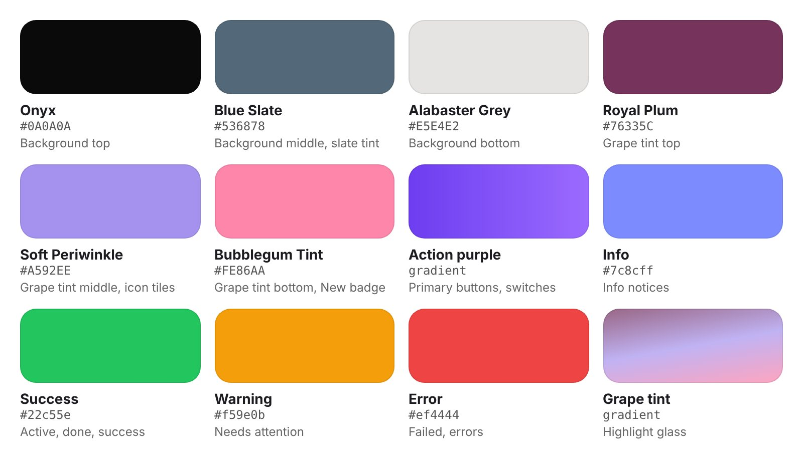

Text on glass is always white with a soft shadow (`0 1px 6px rgba(0,0,0,.3)`). Dark text is only used on solid white pills (selected chip, selected tab).

### Tints (the colour wash on glass)

| Tint | When |
| --- | --- |
| `slate` | Default for every card. |
| `grape` | One highlight per screen area: the key number, the setup checklist, the bottom nav, sheets. Don't make everything grape. |
| `toast` | Toasts only (denser so text reads over anything). |
| `clear` | No wash: only over a photo or a busy background. |

Tints are translucent on purpose (they were made 30% lighter on 9 Nov 2026). Change them only in `components/glass/tints.ts`.

### Background

The aurora image (deep violet → electric purple → cyan, `apps/web/public/glass/bg-aurora.jpg`, 2160 × 3840) sits behind every screen. `GlassPage` puts it on a fixed layer, so cards scroll over it and it stays put on iPhone too. It is shown at 30% strength: a 70% wash of deep navy `rgba(20,17,43,.7)` sits over it so it stays calm behind the cards. While it loads, the screen shows `#14112b`. Don't put screens on plain white: the glass needs colour behind it. To change it, replace that one file.

### Type

| Role | Font | Size / weight |
| --- | --- | --- |
| Screen greeting / name | Outfit | 20px / 600 |
| Card title | Outfit | 18px / 600 |
| Sheet title | Outfit | 21px / 600 |
| Big number (stat) | Outfit | 28px / 600 |
| Body | Hanken Grotesk | 15px (14px in dense rows) / 400–600 |
| Small / meta | Hanken Grotesk | 13px |
| Badges, nav labels | Hanken Grotesk | 12px / 11px, 600–700 |
| Section label | Hanken Grotesk | 13px / 700, uppercase, 0.06em tracking |

Inputs are always 16px so iPhones don't zoom in.

### Spacing

- Page: 24px top, 16px sides, 130px bottom (space for the nav). Max content width 520px (`wide`: 1100px).
- Between sections: 28px. Between cards in a grid: 12px. Inside a card: 20px (14–18px for compact cards).
- Stacks inside a card: 12px (`g-stack`). Rows of buttons/badges: 10px (`g-row`).

### Corners

| Thing | Radius |
| --- | --- |
| Cards | 24px (header 28, sheet 32, toast 22, nav 30) |
| Buttons | 16px (small 13px) |
| Inputs, search, steps, notices | 14–16px |
| Quick-action tiles | 18px; icon tiles 14px (64px tile: 18–20px) |
| Chips, badges, switches, avatars | fully round |

### Motion

Fast and soft: 0.15–0.2s for colour and press states, 0.25–0.3s for sheets and toasts (`cubic-bezier(.2,.8,.2,1)`). Pressed buttons scale to 97%. Everything respects "reduce motion".

### Icons

24px grid, 1.8px stroke, round caps, `currentColor`, shown at 18–22px. Add new ones to `components/glass/icons.tsx` in the same style. No emoji as icons.

---

## 4. Glass rules (read before building)

1. **Real glass only for containers:** cards, header, nav, sheets, toasts. Everything inside a card (buttons, chips, fields, rows) uses the light see-through classes (`g-btn-glass`, `g-chip`, …). Many refraction filters on one screen is slow on phones.
2. **Aim for 12 or fewer glass pieces per screen.**
3. **Never** put glass inside a parent that has both `overflow: hidden` and rounded corners: Chrome draws a hard rectangle around the card. Clip backgrounds on their own layer.
4. **Overlays** (sheets, toasts, menus) must be portalled. `GlassSheet` and `GlassToast` already do this; a glass card's transform would otherwise trap `position: fixed`.
5. The glass library is loaded in the browser only. Screens that use the kit are client components (`'use client'`).
6. Don't edit the library or copy its effect into CSS. Adjust only through `LiquidGlassCard` props.
7. Glass settings (defaults in `liquid-glass-card.tsx`): mode `prominent`, displacement 7, blur 0, saturation 170, aberration 20, elasticity 0.1, overLight off.

### Browser support

| Browser | What people see |
| --- | --- |
| Chrome, Edge, Android | Full glass: edge refraction, blur, colour boost |
| Safari (Mac and iPhone), Firefox | Blur and colour boost, no edge bending (library limit). Still looks clean; no fallback needed. |

---

## 5. Components and their classes

Every photo is a real screenshot of `/lab/components` on a 390px phone screen (Chrome). Copy working code from `apps/web/app/lab/components/` (parts-a, parts-b, parts-c).

### 5.1 Top header
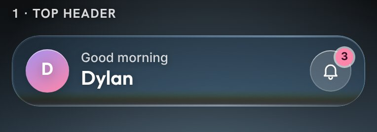

`GlassCard padding="14px" cornerRadius={28}` → `g-header`, `g-avatar`, `g-header-text` (`small` + `strong`), `g-icon-btn` with `g-dot-count` for unread.

### 5.2 Buttons
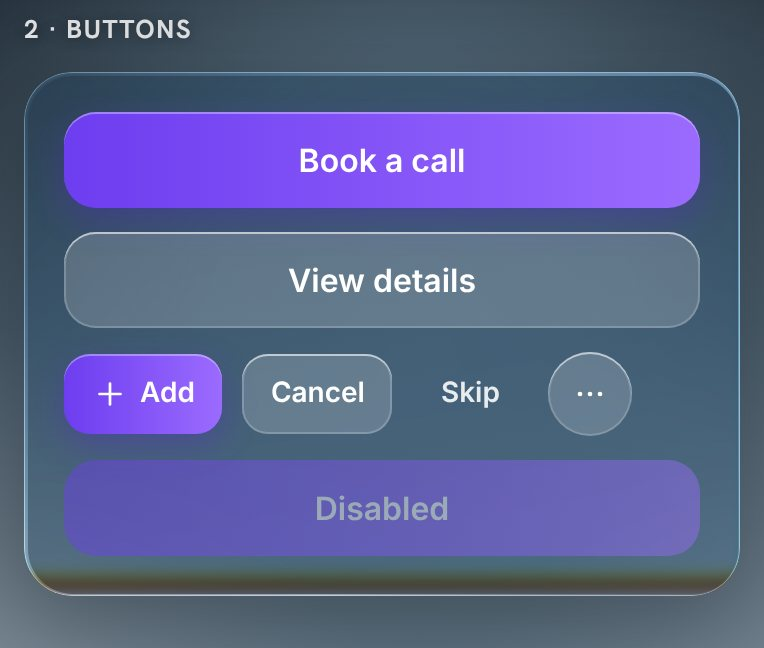

- `g-btn g-btn-primary`: the main action. One per card.
- `g-btn g-btn-glass`: secondary action.
- `g-btn g-btn-ghost`: low-key ("Skip", "Not now").
- Add `g-btn-sm` for small. `g-icon-btn` for round icon buttons (always with `aria-label`).
- `disabled` fades the button to 45%.

### 5.3 Stat tiles
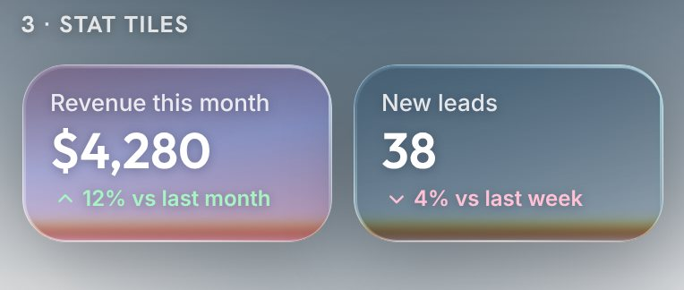

`g-grid2` of `GlassCard padding="16px"` → `g-stat` (`small` label, `strong` number, `g-trend up` or `g-trend down`). Use `tint="grape"` for the one number that matters most.

### 5.4 Badges and filter chips
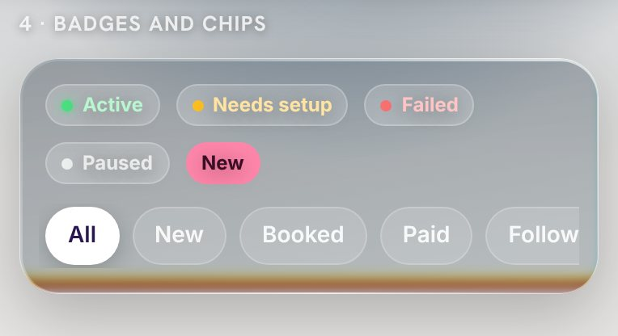 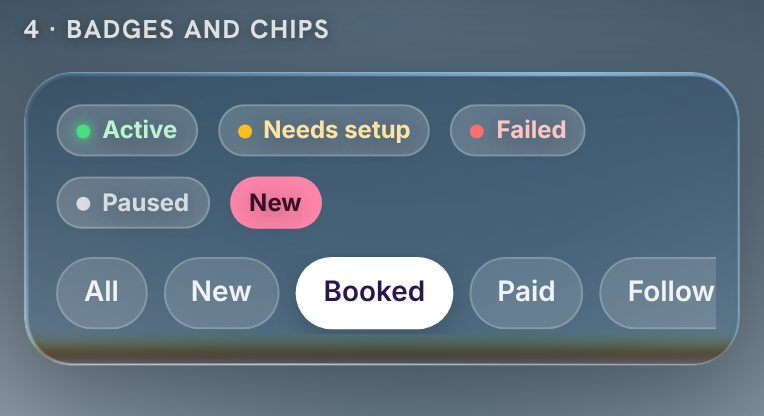

- Badges: `g-badge` + `ok` / `warn` / `bad` / `muted` / `new`. Add `<i />` inside for the coloured dot.
- Chips: `g-chips` (scrolls sideways) of `g-chip` buttons. Selected = class `on` + `aria-pressed`. Right photo: "Booked" selected.

### 5.5 List card
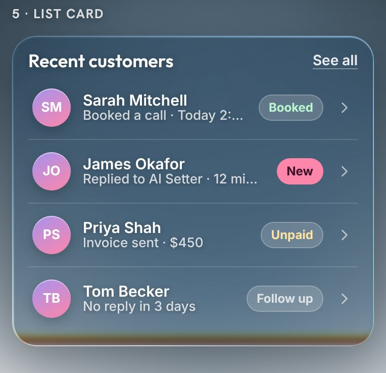

`g-list` → `g-list-head` (`h3` + `g-link` "See all"), then a `ul` of `g-list-row` buttons: `g-avatar sm`, `g-list-text` (`strong` + `small`), a badge, `g-chev`. Long text is cut with "…".

### 5.6 Quick actions
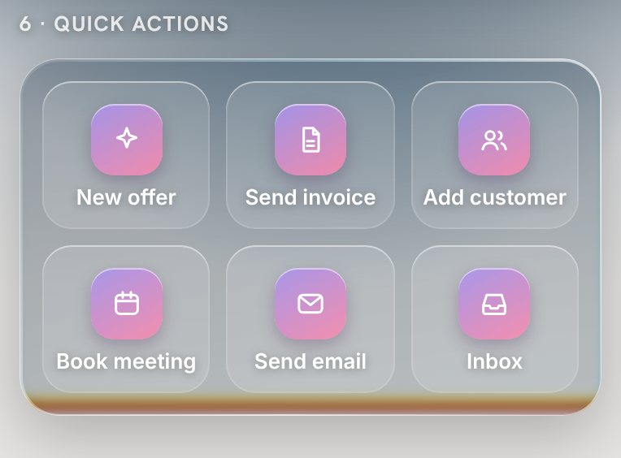

`g-actions` (3 columns) of `g-action` buttons, each with a `g-action-icon` tile and a short label (two words max).

### 5.7 Search and segmented tabs
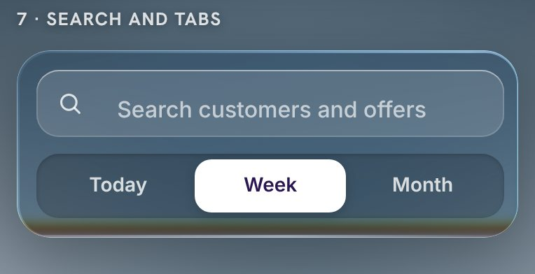 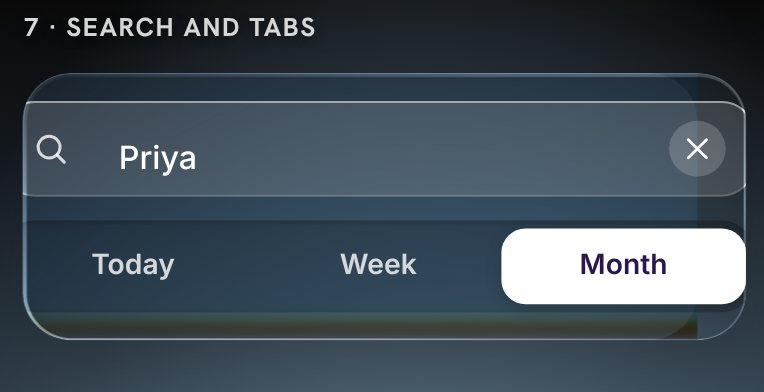

- Search: `label.g-search` → icon, `input type="search"`, and a `g-search-clear` button once something is typed (right photo).
- Tabs: `g-seg` (`role="tablist"`) of `g-seg-btn` (`role="tab"`, `aria-selected`, class `on`).

### 5.8 Form fields
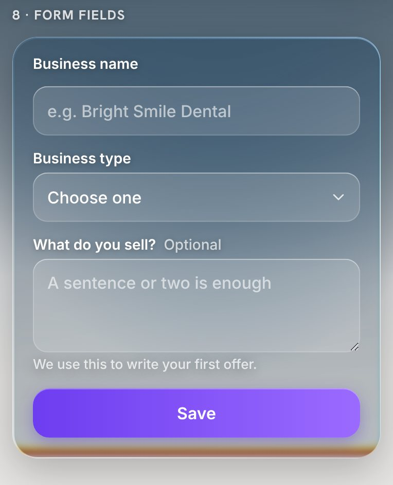 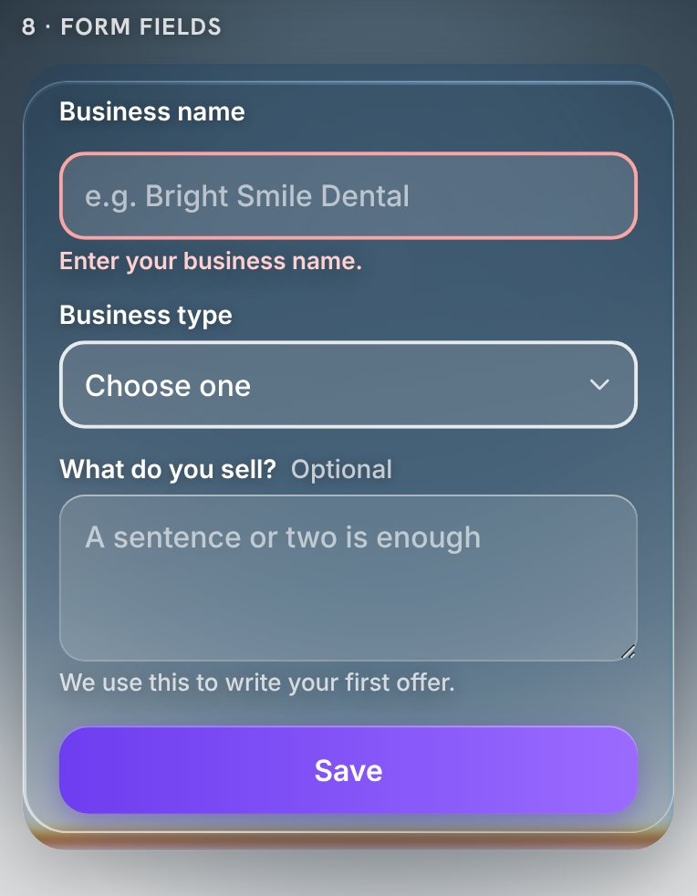

`g-form` → `g-field` (`label` + `input` / `textarea`). Dropdowns sit in `g-select` with a chevron `span`. Helper text `g-field-hint`, optional label `g-optional`. Errors (right photo): red outline from `aria-invalid="true"` and a `g-field-error` message linked with `aria-describedby`. Inputs are 16px so iPhones don't zoom.

### 5.9 Setup checklist
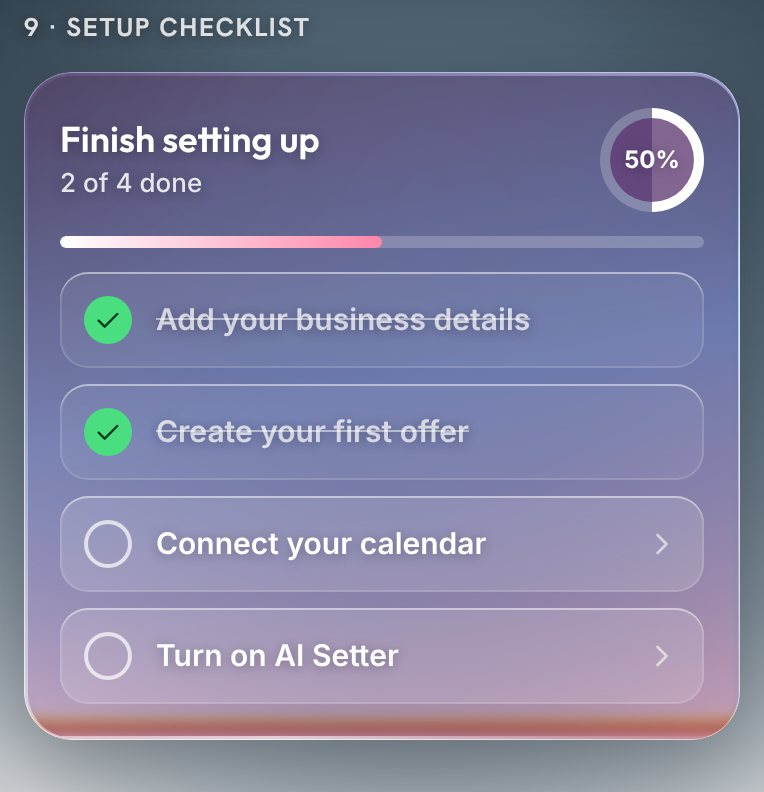

`GlassCard tint="grape"` → `g-setup`: `g-setup-head` with a `g-ring` (set `--p` to the percent), a `g-bar`, then `g-step` buttons (`done` adds the green tick and strike-through).

### 5.10 Notices
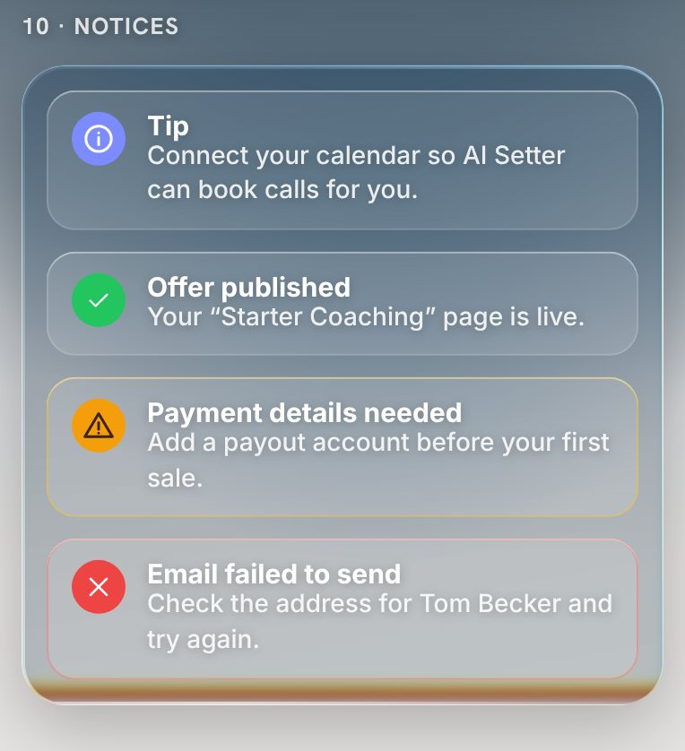

`g-notice` + `info` / `ok` / `warn` / `bad`, with a `g-notice-icon`. Title in `strong`, one sentence in `p`. Use `role="alert"` for warn and bad, `role="status"` otherwise.

### 5.11 Empty state
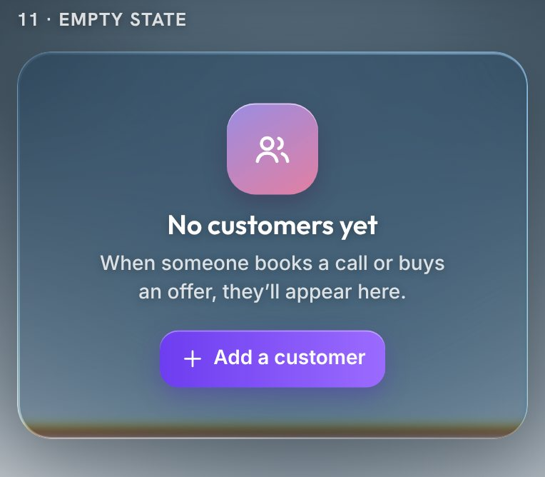

`g-empty` → `g-empty-icon`, `h3` (what's missing), `p` (what will appear here), one primary button (the next step).

### 5.12 Bottom sheet
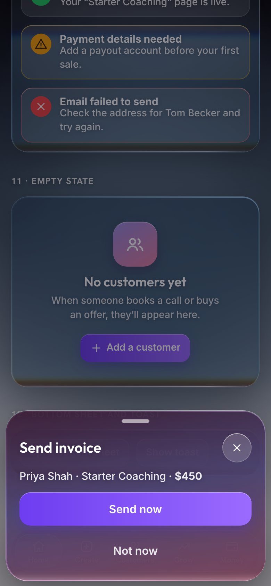

```tsx
<GlassSheet open={open} onClose={() => setOpen(false)} title="Send invoice">
  <p>Priya Shah · Starter Coaching · <b>$450</b></p>
  <button type="button" className="g-btn g-btn-primary">Send now</button>
  <button type="button" className="g-btn g-btn-ghost">Not now</button>
</GlassSheet>
```

Dims the screen, slides up, closes on the dim area, the ✕ button or Escape.

### 5.13 Toast
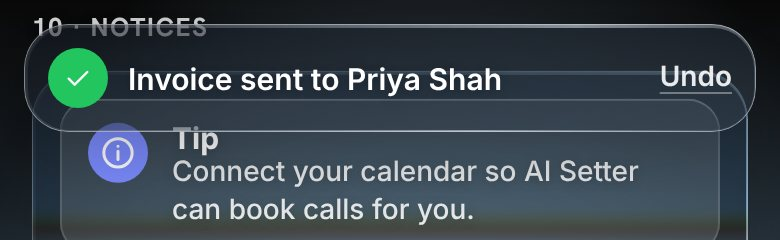

```tsx
<GlassToast open={done} onClose={() => setDone(false)} action={{ label: 'Undo', onClick: undo }}>
  Invoice sent to Priya Shah
</GlassToast>
```

Appears at the top, disappears after about 3 seconds.

### 5.13b Skip link and scrolling sheet lists
`g-skip` (anchor, hidden until keyboard focus) points at a `g-main` wrapper (`id`, `tabIndex={-1}`) around the screen content. `g-sheet-scroll` on a list inside a `GlassSheet` makes it scroll at 55% of the screen height. Example: `apps/web/app/ui/home-view.tsx`. The glass UI is dark only, so there is no theme switch.

### 5.14 Bottom nav
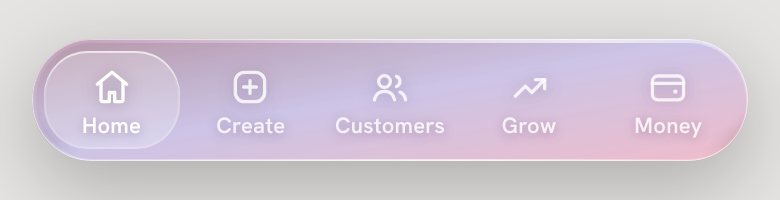<br>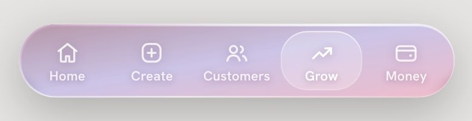

`<GlassBottomNav current="grow" asLinks />`. The selected area gets the light pill. Always the five areas, always this order.

### 5.15 Feature card (e.g. AI Setter)
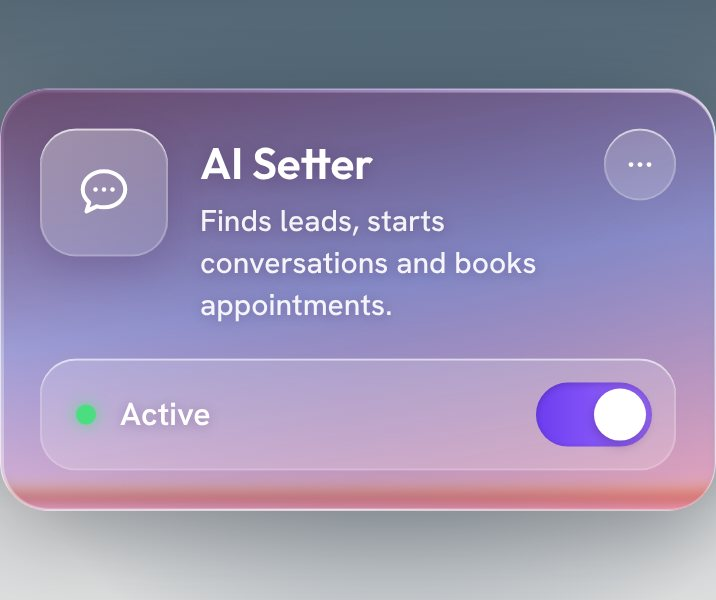

`GlassCard tint="grape"`: icon tile, title, one-line description, a "…" button, and an inner status bar with a dot, label and switch. Example: `apps/web/app/lab/glass-card/ai-setter-card.tsx`.

---

## 6. States every screen must have

- **Loading:** keep the layout; show placeholder rows (skeletons): `g-skel` plus `g-skel-line` (text), `g-skel-num` (big number) or `g-skel-row` (list row / step). Pulses, still under "reduce motion". Never a blank screen. Example: `apps/web/app/ui/home-view.tsx`.
- **Empty:** the empty state (11) with one clear next step.
- **Error:** an error notice (10, `bad`) saying what happened and what to do; keep what the person typed.
- **Disabled:** `disabled` attribute (buttons fade to 45%). Say why nearby if it isn't obvious.
- **Success:** a toast (12) for quick actions; a success notice for things that stay true.

---

## 7. Words and formats

- Plain, friendly, short. Write for a beginner: "Connect your calendar", not "Configure calendar integration".
- Buttons say what happens: "Send invoice", "Book a call". Avoid "Submit", "OK".
- Sentence case everywhere except the small section labels.
- Money: Australian dollars, `$4,280` (`$4,280.50` only when cents matter). Dates: `9 Nov 2026`, times `2:30 pm`. Relative times for recent things: "12 min ago".
- Errors: what happened + what to do. "Email failed to send. Check the address and try again."

---

## 8. Accessibility (must pass)

- Tap targets at least 44 × 44px (buttons 48, small buttons 40 and chips 36 are known exceptions to fix; see section 10).
- Every icon-only button has an `aria-label`. Decorative icons have `aria-hidden`.
- Visible focus: white 2px outline on everything you can tab to (already in the classes).
- Text on glass: white with shadow; check contrast over the light bottom of the background.
- Sheets: Escape closes, focus moves into the sheet. Toasts are announced (`role="status"`).
- Respect "reduce motion" (already in the classes).

---

## 9. Files

| File | What |
| --- | --- |
| `apps/web/components/glass/glass.tsx` | `GlassPage`, `GlassCard`, `GlassSection`, `GlassBottomNav`, `GlassSheet`, `GlassToast` |
| `apps/web/components/glass/glass-ui.css` | All `g-*` classes |
| `apps/web/components/glass/reset.css` | Tailwind preflight + undo of old global styles, scoped to `.vglass` |
| `apps/web/components/glass/tints.ts` | Tint colours |
| `apps/web/components/glass/icons.tsx` | Icons |
| `apps/web/components/ui/liquid-glass-card.tsx` | `LiquidGlassCard` / `LiquidGlassBlock`: the only place the library is used |
| `apps/web/app/lab/components/` | The live gallery |

**Adding a component:** build it in the gallery first, use existing tokens and classes, add its `g-*` styles to `glass-ui.css`, then add a row to section 5 here.

---

## 10. Still to build (next)

**Look to review:** the photos in section 5 were taken on the earlier grey background (before the aurora image); retake them with the gallery. Content scrolling behind the bottom nav shows through its labels.


Top bar with back button, action menu for "…", tooltips, switch / checkbox / radio as kit components, onboarding wizard, date and time picker, booking slots, chat bubbles (Inbox, AI Setter), revenue chart, invoice / payment / offer cards, confirm dialog for deletes, loading skeletons, error and offline screens, file upload, desktop sidebar (bottom nav becomes a sidebar on wide screens), and raising chips and small buttons to 44px tap targets.
